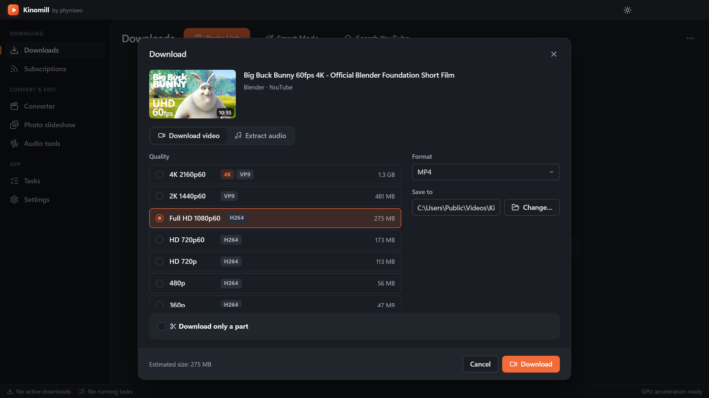
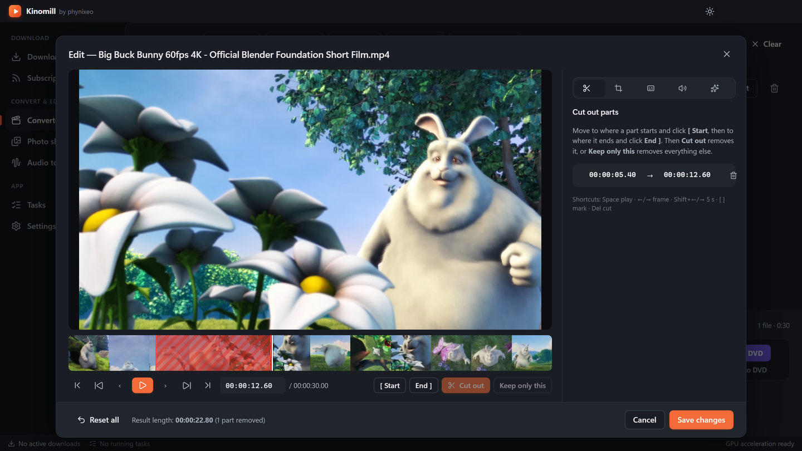
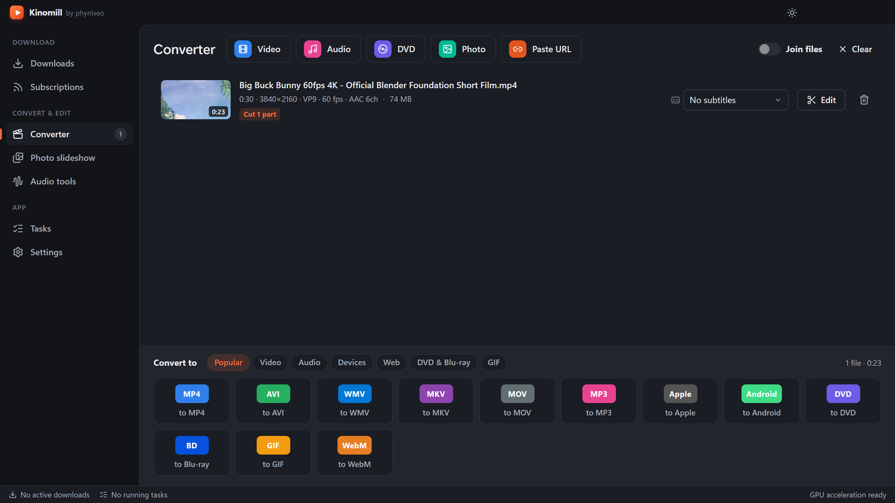
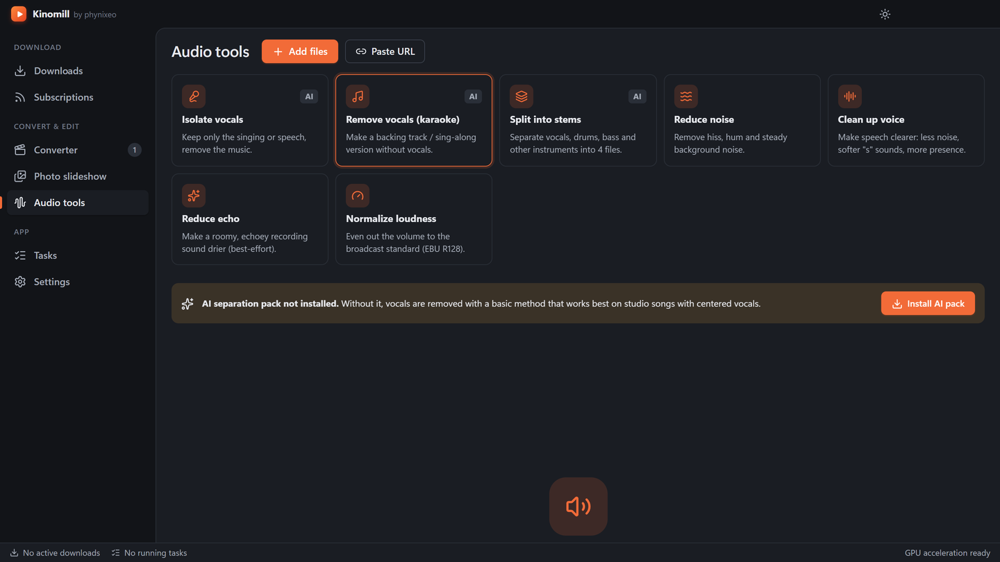

<div align="center">


# Kinomill

**by phynixeo**

Download videos and music from YouTube and 1000+ sites, then convert, trim, join, burn and clean them up, all in one free Windows app.

[](https://github.com/phynixeo/kinomill/releases/latest)
[](https://github.com/phynixeo/kinomill/releases)
[](LICENSE)


[**⬇ Download for Windows**](https://github.com/phynixeo/kinomill/releases/latest/download/Kinomill-Setup.exe) · [What's new](https://github.com/phynixeo/kinomill/releases/latest) · [Watch on YouTube](https://youtu.be/LdQPD1LblOQ) · [Report a bug](https://github.com/phynixeo/kinomill/issues/new/choose)

</div>

## What it does

| Download | Edit & convert |
|---|---|
|  |  |
|  |  |

### Downloader

- **Paste Link:** quality up to 8K, HDR and 60 fps, plus 360° and 3D video.
- **Formats:** MP4, MKV, WebM or MOV video, or MP3, M4A, Opus, OGG, FLAC or WAV audio.
- **Playlists and whole channels**, with **subscriptions** that download new uploads automatically.
- **Subtitles** (including auto-translated ones), embedded or as separate files, plus multi-language audio tracks and chapters.
- **Download only a part** of a video.
- **Smart Mode:** one click with your saved settings.
- **In-app YouTube search.**
- **Sign-in** for private, age-restricted and members-only videos (see [Signing in](#signing-in)).
- **Network control:** proxy, speed limit and simultaneous downloads.
- **Housekeeping:** skip duplicates, SponsorBlock, clipboard watching, and import/export of your download list.
- **Private Mode** with a password.

### Converter and editor

- **40+ targets:** MP4, AVI, WMV, MKV, MOV, WebM, MPEG, FLV, 3GP, OGV, HTML5 video, GIF, MP3, AAC, WAV, FLAC, OGG, Opus, WMA, AC3 and AIFF.
- **Device presets:** Apple, Android, Samsung, Sony, Xbox and Smart TV.
- **DVD and Blu-ray:** as a folder, an ISO image, or a burned disc.
- **Editing:** cut out parts, rotate, flip, crop, remove black bars automatically or add them, subtitles burned in with a custom font, a text or logo watermark, speed, fades, volume and loudness, colour, and deinterlacing.
- **Join files**, save custom presets, use two-pass encoding, and limit the output size.
- **GPU acceleration** on NVIDIA, Intel and AMD.
- **Photo slideshows** with music.

### Audio tools

- **Vocals:** isolate them, or remove them for karaoke.
- **Split into stems.** This needs the optional AI pack (Demucs).
- **Clean-up:** reduce noise, clean up voice, reduce echo, and normalize loudness.

## Install

Requirements: Windows 10 or 11, 64-bit, and an internet connection on the first start.

1. **[Download Kinomill-Setup.exe](https://github.com/phynixeo/kinomill/releases/latest/download/Kinomill-Setup.exe)**. This always gets the latest version. You can also find it under **Assets** on the [latest release](https://github.com/phynixeo/kinomill/releases/latest).
2. Run it.
   - Windows may show "Windows protected your PC", because the installer is not code-signed yet. Click **More info**, then **Run anyway**.
   - Optionally, compare the file's SHA-256 with `SHA256SUMS.txt` on the release page first. In PowerShell, run `Get-FileHash .\Kinomill-Setup.exe`.
3. Choose where to install and finish. A desktop shortcut is created.
4. On the first start, Kinomill downloads its engines from their official GitHub releases into `%APPDATA%\Kinomill\bin`:
   - **yt-dlp:** the download engine.
   - **Deno:** needed by yt-dlp for YouTube.
   - **FFmpeg:** only if it is not already installed on the PC.

   This is a one-time download of a few hundred MB. tsMuxeR (for Blu-ray) and the optional AI pack (about 2–3 GB, needs Python 3.9–3.12) are only fetched when you use them.

**Update Kinomill:** download the new installer and run it. Your settings and downloads list are kept. Kinomill checks for a new yt-dlp once a day; you can also update it in **Settings → Components**.

**Uninstall:** go to **Windows Settings → Apps → Kinomill → Uninstall**. Your settings, engines and login cookies stay in `%APPDATA%\Kinomill`; delete that folder to remove everything. Downloaded files are saved to `Videos\Kinomill` by default, and Kinomill never deletes them.

## Signing in

For private, age-restricted or members-only videos, go to **Settings → Accounts & network → Sign in to YouTube**.

1. Kinomill opens **your own Chrome, Edge or Brave** with a separate profile. It does not use an embedded window, because Google blocks sign-in from those. Your everyday browser profile is not touched.
2. Sign in, then click **Done** in Kinomill (or just close that browser window).
3. Kinomill keeps only the cookies of the sites you opened. They are saved on this PC (`%APPDATA%\Kinomill\cookies.txt`) and only passed to yt-dlp when downloading.

You can also use your browser's existing login, or a `cookies.txt` file. **Sign out** deletes the saved cookies and the sign-in profile.

## Privacy

Kinomill has **no accounts, telemetry or analytics**. It only connects to:

- GitHub, to download and update its engines;
- the sites you download from, or search;
- PyPI and PyTorch, only if you install the optional AI pack.

## FAQ

**A site stopped working.**
Sites change often. First update yt-dlp in **Settings → Components**. If the problem is still there, the same failure probably happens in plain yt-dlp: check [yt-dlp's issues](https://github.com/yt-dlp/yt-dlp/issues).

**Why does it download engines instead of including them?**
So you always get current official builds (sites break old ones quickly), and to keep the installer small and the licenses clean.

**Does it work on macOS or Linux?**
Not yet. Kinomill is built and tested for Windows only.

**Can it download from Netflix, Spotify or other DRM-protected services?**
No. Kinomill does not and will not bypass DRM.

## Build from source

Requirements: Windows 10 or 11, [Node.js](https://nodejs.org/) 22 or newer, and Git.

```bash
git clone https://github.com/phynixeo/kinomill.git
cd kinomill
npm ci
npm run app      # build and start the desktop app
npm run dist     # build the installer into release\
```

| Command | What it does |
|---|---|
| `npm run browser` | Builds and serves the full app, with its real backend, at http://127.0.0.1:5199 for testing in a normal browser |
| `npm run typecheck` | TypeScript check |
| `npm test` | Engine tests (need FFmpeg; some download a short public video with yt-dlp) |

**Project layout:**
- `electron/`: main process and backend (`core/download`, `core/convert`, `core/disc`, `core/audio`)
- `src/`: React UI
- `shared/`: types and format presets
- `tests/`: engine tests

## Contributing

Bug reports, ideas and pull requests are welcome. Read [CONTRIBUTING.md](CONTRIBUTING.md) first, and follow the [Code of Conduct](CODE_OF_CONDUCT.md). Report security issues privately, as described in [SECURITY.md](SECURITY.md).

## Credits

Kinomill stands on the shoulders of open-source projects. The engines are downloaded from their official releases and keep their own licenses:

- [yt-dlp](https://github.com/yt-dlp/yt-dlp): Unlicense
- [FFmpeg](https://ffmpeg.org/) (Windows builds by [BtbN](https://github.com/BtbN/FFmpeg-Builds)): GPL / LGPL
- [Deno](https://github.com/denoland/deno): MIT
- [tsMuxeR](https://github.com/justdan96/tsMuxer): Apache-2.0
- [Demucs](https://github.com/adefossez/demucs): MIT

Built with [Electron](https://www.electronjs.org/), [React](https://react.dev/) and [Lucide](https://lucide.dev/). The full list is in [THIRD_PARTY_NOTICES.md](THIRD_PARTY_NOTICES.md).

Screenshots and the tour video use *Big Buck Bunny* © 2008 Blender Foundation, [peach.blender.org](https://peach.blender.org/), [CC BY 3.0](https://creativecommons.org/licenses/by/3.0/).

## License

[MIT](LICENSE) © 2026 phynixeo

## Disclaimer

Only download content you have the right to download, and respect the terms of service of the sites you use. Kinomill is an independent project and is not affiliated with, or endorsed by, YouTube, Google or any other site it works with. All trademarks belong to their owners.
